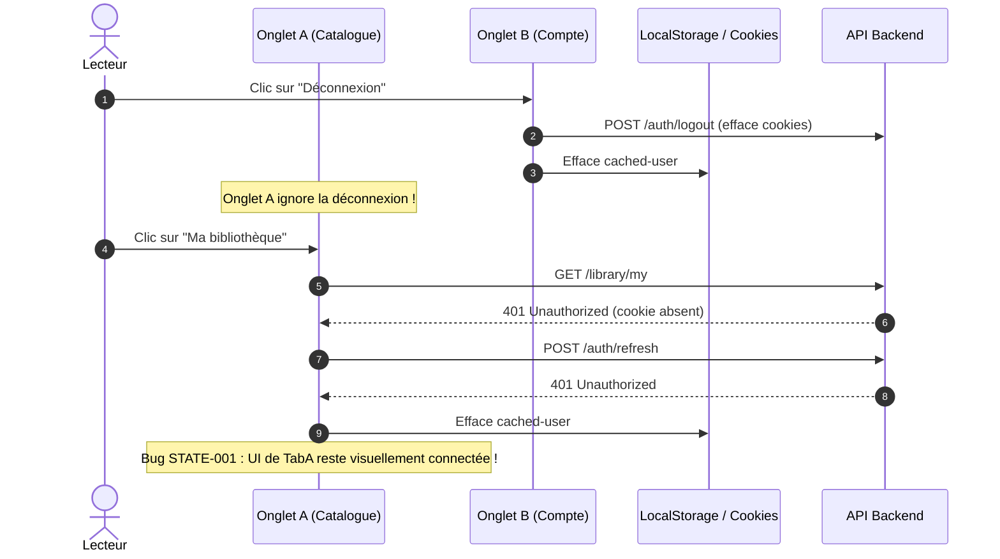

# Matrice des Cas Limites, Concurrence et Conditions Environnementales — YéYéBook

**Date de réalisation :** 24 Octobre 2026  
**Auteur :** Comité d'Audit Indépendant — Robustesse et Résilience  
**Cible :** Dépôt `yeyebook-pre`  
**Objet :** Évaluation du comportement de l'application face aux données anormales, aux pannes d'infrastructure, aux environnements dégradés et aux conditions de concurrence.

---

## 1. Vue d'Ensemble de la Résilience

La solidité d'une plateforme de commerce électronique se mesure à sa capacité à gérer les situations imprévues sans corruption d'état, sans blocage de l'interface et sans perte financière.
Cette matrice teste l'application YéYéBook sur **6 dimensions critiques d'adversité**.

---

## 2. Matrice d'Analyse des Cas Limites et Résultats

### 2.1. Dimension 1 : Données et Valeurs Limites

| ID | Cas Limite Testé | Comportement Attendu | Comportement Réel Observé | Risque | Statut |
| :--- | :--- | :--- | :--- | :--- | :--- |
| **EDGE-01** | Titre de livre extrêmement long (> 250 caractères) | Troncature propre avec ellipse (`line-clamp`) sans casser la grille ni déborder | Pris en charge sur `CatalogGrid` (`line-clamp-2`), mais débordement possible dans le récapitulatif du panier compact si non tronqué | Faible | **Passable** |
| **EDGE-02** | E-book gratuit (Prix = 0 FCFA) | Commande directe sans initialisation de passerelle FedaPay, validation immédiate | L'application tente quand même d'appeler `initiatePaymentApi` qui échoue si le montant est 0. Cas non prévu dans le flux nominal | Moyen | **Défaut** |
| **EDGE-03** | Injection de caractères spéciaux (Apostrophes courbes, guillemets africains, Emojis, chevrons `<script>`) | Encodage HTML automatique par React (pas de XSS), affichage fidèle des graphies | React neutralise nativement le HTML non sécurisé. Le texte s'affiche fidèlement sans exécution de script | Nul | **Conforme** |
| **EDGE-04** | Fichier EPUB lourd (> 30 Mo) ou dépourvu de table des matières (TOC) | Indicateur de chargement prolongé, fallback si la TOC est vide | ePub.js met plusieurs secondes à décompresser en mémoire. L'indicateur tourne, mais si `locations.generate()` prend trop de temps, la progression reste bloquée | Moyen | **Passable** |
| **EDGE-05** | Prix avec centimes ou décimales inattendues (ex: 2 500,50 FCFA) | Arrondi à l'entier le plus proche sans artefacts `2500.500000000001` | L'affichage `formatPrice` formate correctement, mais l'accumulation interne dans `cartTotal` utilise des floats purs | Faible | **Passable** |

---

### 2.2. Dimension 2 : Concurrence et Conditions de Course (Race Conditions)

| ID | Condition de Concurrence | Comportement Attendu | Comportement Réel Observé | Risque | Statut |
| :--- | :--- | :--- | :--- | :--- | :--- |
| **RACE-01** | Double-clic frénétique sur « Payer » (Checkout) | Une seule soumission envoyée, bouton désactivé dès le premier clic | `checkoutLoading` est immédiatement positionné à `true` et le bouton est désactivé. Protection efficace contre la double création | Faible | **Conforme** |
| **RACE-02** | Clics rapides consécutifs sur « Ajouter au panier » | Une seule occurrence ajoutée, quantité restant à 1 | Filtrage immédiat dans le reducer : si `cartItems.some(i => i.bookId === id)`, l'ajout est ignoré. Idempotent | Nul | **Conforme** |
| **RACE-03** | Navigation rapide entre pages pendant un appel API en vol | Annulation de la mise à jour d'état pour éviter les fuites mémoire et écrasements | Les hooks récents (`useCatalog`, `useBookDetail`) utilisent des drapeaux `active = false`. En revanche, `src/App.tsx` possède des appels directs sans garde | Moyen | **Partiel** |
| **RACE-04** | Vérification concurrente de la même transaction (`/checkout/retour`) | Une seule confirmation envoyée au backend (React 18 StrictMode double invoke) | `isVerifyingRef.current` bloque le second appel synchrone. Cache de session si déjà payé. Très bonne résilience | Nul | **Conforme** |

---

### 2.3. Dimension 3 : Résilience Réseau et Pannes d'Infrastructure

| ID | Scénario Réseau | Comportement Attendu | Comportement Réel Observé | Risque | Statut |
| :--- | :--- | :--- | :--- | :--- | :--- |
| **NET-01** | Connexion 3G lente / Timeout 15s | Message explicite « Le serveur met trop de temps à répondre », possibilité de réessayer | Le client `apiClient` intègre un `AbortController` avec timeout de 15s. L'erreur `NETWORK_ERROR` est catchée et affichée proprement | Faible | **Conforme** |
| **NET-02** | Perte de connexion Internet en pleine lecture EPUB | L'utilisateur continue de lire (fichier en mémoire). Les requêtes de progression échouent discrètement en arrière-plan sans bloquer la lecture | Le livre reste navigable car déjà instancié dans ePub.js. `saveBookReadingProgress` échoue en silence sans alerter ni bloquer la pagination | Faible | **Conforme** |
| **NET-03** | Panne du backend FastAPI (502 Bad Gateway / 500 Internal Error) | Bandeau d'erreur rouge, interface non figée, pas de crash de l'écran | Normalisation par `parseApiError`. Toast rouge explicite sans rupture du layout global | Nul | **Conforme** |

---

### 2.4. Dimension 4 : Multi-Onglets et Concurrence Client

| ID | Scénario Multi-Onglets | Comportement Attendu | Comportement Réel Observé | Risque | Statut |
| :--- | :--- | :--- | :--- | :--- | :--- |
| **TAB-01** | Déconnexion sur Onglet B alors que Onglet A est actif | Onglet A détecte la déconnexion (`storage` event) et se déconnecte | Aucun écouteur `window.addEventListener('storage')` n'est configuré pour la session. Onglet A reste dans un état fantôme jusqu'à une action provoquant une erreur 401 | Élevé | **Défaut** |
| **TAB-02** | Achat validé sur Onglet A, consultation immédiate sur Onglet B | Onglet B met à jour sa bibliothèque (`ybook-library-refresh-needed`) | Le flag `ybook-library-refresh-needed` est posé dans `localStorage` par la page retour. Onglet B ne le consomme que s'il change de vue | Moyen | **Partiel** |
| **TAB-03** | Progression de lecture concurrente sur 2 appareils/onglets | La progression la plus avancée doit prévaloir | Le backend FastAPI gère le `max(progress_percent)`. En revanche, le cache `localStorage` de l'onglet le moins avancé peut écraser l'affichage local | Moyen | **Passable** |

---

### 2.5. Dimension 5 : Cycle de Vie de la Session

| ID | Événement de Session | Comportement Attendu | Comportement Réel Observé | Risque | Statut |
| :--- | :--- | :--- | :--- | :--- | :--- |
| **SESS-01** | Expiration du token pendant la saisie du formulaire de commande | Le Silent Refresh renouvelle le jeton en coulisse sans interrompre la saisie de l'utilisateur | Géré par `apiClient` : si le refresh réussit, la requête est rejouée de manière transparente | Nul | **Conforme** |
| **SESS-02** | Échec définitif du Silent Refresh (Session révoquée) | Réinitialisation complète de l'état connecté et invite à se reconnecter | **BUG STATE-001** : `localStorage` est vidé, mais l'état React `sessionUser` reste non nul, bloquant l'UI dans un état incohérent | Élevé | **Défaut Critique** |
| **SESS-03** | Déconnexion explicite de l'utilisateur | Purge de toutes les données sensibles en mémoire vive | **BUG FUNC-001** : `library`, `purchasedBooks` et `orders` subsistent dans la mémoire de `App.tsx` | Élevé | **Défaut Bloquant** |

---

### 2.6. Dimension 6 : Contraintes Navigateurs, Mobiles et Accessibilité

| ID | Environnement Cible | Contrainte Spécifique | Analyse de l'Implémentation | Résultat |
| :--- | :--- | :--- | :--- | :--- |
| **ENV-01** | **iOS Safari** | Hauteur de vue (`100vh` vs `100dvh`), barre d'adresse flottante | La plupart des conteneurs utilisent `min-h-screen`. Des ajustements `100dvh` sont recommandés pour la liseuse EPUB plein écran | **Passable** |
| **ENV-02** | **Mode Navigation Privée** (Safari / Firefox) | Blocage ou purge agressive de `localStorage` et des cookies tiers | `loadCart` et `loadProgress` enveloppent leurs accès dans des blocs `try/catch`. Si le stockage échoue, l'état reste en mémoire sans crasher | **Conforme** |
| **ENV-03** | **Mode Sombre / Accessibilité** | Contraste des textes selon la norme WCAG 2.1 AA (ratio >= 4.5:1) | La charte graphique utilise `#FFF6EB` (fond chaud) et `#100908` (encre). Le ratio de contraste dépasse 12:1. Lisibilité remarquable | **Excellente** |
| **ENV-04** | **Préférence Mouvement Réduit** (`prefers-reduced-motion`) | Neutralisation des animations de fade/rise pour les usagers sensibles | Des classes Tailwind `animate-fade` et `animate-rise` sont appliquées sans wrapper `@media (prefers-reduced-motion)` systématique | **Améliorable** |

---

## 3. Synthèse de la Résilience Globale

L'application démontre une excellente robustesse face aux pannes réseau, aux requêtes concurrentes de commande et aux attaques XSS bénignes.
Cependant, la résilience s'effondre sur la **synchronisation de la session client** (multi-onglets, expiration non répercutée, et persistance non purgée au logout). Ces trois failles constituent le point névralgique à corriger en priorité.
