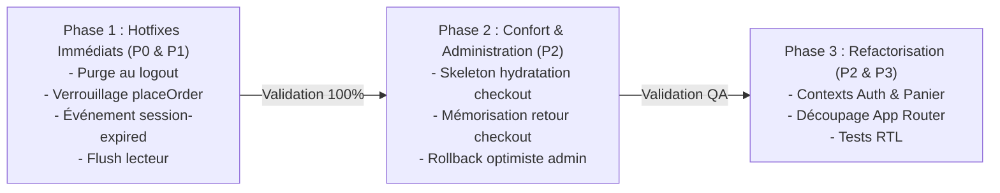

# Rapport Final d'Audit Indépendant — Correction Fonctionnelle, Logique et Robustesse YéYéBook

**Date de clôture :** 24 Octobre 2026  
**Instance d'évaluation :** Comité d'Audit Indépendant — Architecture, Sécurité et Qualité de Production  
**Cible :** Plateforme de commerce électronique YéYéBook Frontend (`yeyebook-pre`)  
**Backend de référence :** FastAPI / Python 3.12 (`http://localhost:8001`)  
**Statut de la revue :** Définitif  
**Verdict :** ⛔ **BLOQUÉ EN L'ÉTAT — REMÉDIATION IMPÉRATIVE AVANT PRODUCTION**

---

## 1. Résumé Exécutif

À la demande du commanditaire, le présent comité a conduit une évaluation contradictoire et approfondie du frontend YéYéBook.
L'objectif n'était plus de valider simplement la réussite de la compilation TypeScript ou le passage d'une suite de tests existante, mais de sonder la **vérité d'exécution** du système :
- Les flux d'achats sont-ils infalsifiables ?
- La confidentialité des comptes et des bibliothèques est-elle garantie ?
- L'état de l'application est-il résilient aux déconnexions, aux pertes réseau et aux anomalies d'API ?
- Le code source est-il maintenable par une équipe d'ingénierie sans risques permanents de régression ?

### Les Deux Constats Majeurs de l'Audit :
1. **Une excellente maturité des modules périphériques :** Le client HTTP (`apiClient`), la normalisation des erreurs d'API, la sécurisation de la route de retour `/checkout/retour` et les hooks modulaires sous `src/features/*` témoignent d'une solide expertise technique.
2. **Des failles logiques et de sécurité critiques dans le shell central :** Le composant racine `src/App.tsx` (5 324 lignes) contient deux failles classées **P0 (Bloquantes)** qui interdisent formellement toute mise en production dans son état actuel :
   - **Une fuite de données confidentielles entre utilisateurs distincts (`FUNC-001`) :** La déconnexion ne purge pas la mémoire vive de la bibliothèque, exposant les titres et commandes d'un utilisateur à l'utilisateur suivant sur un même poste.
   - **Un contournement de paiement critique avec attribution gratuite (`FUNC-002`) :** Dans `placeOrder`, si l'agrégateur de paiement FedaPay ne retourne pas d'URL de redirection, l'application auto-valide la commande, s'attribue les e-books et confirme le paiement sans transaction financière.

---

## 2. Tableau de Bord Qualité et Robustesse

```
+-----------------------------------------------------------------------------------+
| TABLEAU DE BORD D'ÉVALUATION DE PRODUCTION (SCORECARD)                            |
+-----------------------------------------------------------------------------------+
| Axe d'Évaluation                  | Score / 10 | Statut      | Observation clé   |
+-----------------------------------+------------+-------------+--------------------+
| Sécurité des paiements & Tunnel   |   3.5/10   | CRITIQUE    | Faille P0 dans     |
|                                   |            |             | placeOrder.        |
| Confidentialité & Gestion session |   4.0/10   | CRITIQUE    | Fuite P0 au logout |
|                                   |            |             | + 401 silencieux.  |
| Expérience d'achat & Navigation   |   7.0/10   | PASSABLE    | Flash checkout et  |
|                                   |            |             | perte retour login.|
| Liseuse EPUB & Persistance        |   7.5/10   | ACCEPTABLE  | Bonne base ePub.js,|
|                                   |            |             | perte flush unmount|
| Résilience réseau & Erreurs API   |   9.0/10   | EXCELLENT   | Client HTTP et CSP |
|                                   |            |             | exemplaires.       |
| Architecture & Maintenabilité     |   4.5/10   | INSUFFISANT | Monolithe App.tsx  |
|                                   |            |             | de 5 324 lignes.   |
| Couverture réelle de tests        |   5.0/10   | INSUFFISANT | 75 tests mais 0%   |
|                                   |            |             | sur le shell App.  |
+-----------------------------------------------------------------------------------+
| SCORE GLOBAL DE CONFIANCE         |   5.8/10   | PRODUCTION INTERDITE             |
+-----------------------------------------------------------------------------------+
```

---

## 3. Registre Synthétique des Anomalies Détectées

| ID | Domaine | Sév. | Certitude | Fichier & Lignes | Impact Métier / Utilisateur |
| :--- | :--- | :---: | :---: | :--- | :--- |
| **FUNC-001** | Session / Bibliothèque | **P0** | **Confirmé** | `src/App.tsx`<br>`L1257-1265` | **Violation de confidentialité :** Les livres et commandes de l'utilisateur A restent visibles pour l'utilisateur B après déconnexion. |
| **FUNC-002** | Paiement / Commande | **P0** | **Confirmé** | `src/App.tsx`<br>`L887-900` | **Contournement financier :** Attribution gratuite des e-books et vidage du panier si l'URL de paiement est absente. |
| **STATE-001**| Authentification / API | **P1** | **Confirmé** | `src/lib/api-client.ts`<br>`src/features/auth/auth.api.ts` | **Blocage UX :** En cas d'expiration de session, l'état React reste figé en "connecté", provoquant des erreurs 401 en boucle. |
| **DATA-001** | Liseuse EPUB | **P1** | **Confirmé** | `src/features/reader/EpubWebReader.tsx`<br>`L292-298` | **Perte de données :** Progression non sauvegardée lors d'un changement de page rapide ou fermeture immédiate de la liseuse. |
| **STATE-002**| Espace Administration | **P2** | **Confirmé** | `src/App.tsx`<br>`L913-1018` | **Incohérence des données :** Actions administratives optimistes sans rollback en cas d'erreur API (faux toasts de succès). |
| **UX-001**   | Panier / Checkout | **P2** | **Confirmé** | `src/App.tsx`<br>`L3169-3184` | **Défaut visuel :** Flash de l'écran « Votre panier est vide » lors de l'accès direct à `/checkout` avant l'hydratation. |
| **NAV-001**  | Tunnel d'Achat | **P2** | **Confirmé** | `src/App.tsx`<br>`L850-856` | **Friction d'achat :** L'utilisateur redirigé vers `/login` depuis le checkout est renvoyé à l'accueil après connexion au lieu du checkout. |
| **ARCH-001** | Architecture | **P2** | **Confirmé** | `src/App.tsx`<br>`5 324 lignes` | **Dette technique :** Monolithe client écrasant le découpage App Router, réexécutant tous les montages à chaque changement d'URL. |
| **DATA-002** | Calculs Financiers | **P3** | **Confirmé** | `src/App.tsx`<br>`L427-437` | **Précision monétaire :** Sommes flottantes sans arrondi systématique (`Math.round`), risque d'artefacts décimaux. |

---

## 4. Analyse des Risques Résiduels pour la Production

Si le déploiement était opéré sans corriger ces anomalies :
1. **Risque Juridique et Réputationnel (RGPD / Données Personnelles) :**
   Dans un contexte de bornes partagées, de médiathèques, d'universités ou de familles, un utilisateur consultant ses e-books découvrira les achats, adresses e-mail et numéros de téléphone du précédent utilisateur connecté sur le navigateur.
2. **Risque Financier Direct :**
   En cas d'incident technique temporaire sur l'API FedaPay ne retournant pas de lien d'autorisation, des centaines de commandes pourraient être validées à tort dans le panier des clients, créant un contentieux lors de la coupure de l'accès backend.
3. **Risque Opérationnel d'Administration :**
   Les administrateurs recevront des confirmations de suppression ou de publication qui n'auront pas été enregistrées en base, générant des incohérences de catalogue impossibles à diagnostiquer sans audit des logs backend.

---

## 5. Plan de Remédiation Priorisé en 3 Phases

Pour permettre une mise en production sécurisée et sereine, le comité recommande d'exécuter la remédiation selon la chronologie suivante :



### Phase 1 : Hotfixes Critiques et Blocage des Risques P0/P1 (Obligatoire avant tout pilote)
1. **Corriger `handleLogout` dans `src/App.tsx` :**
   Appeler explicitement `setLibrary([])`, `setPurchasedBooks([])`, `setOrders([])` et `setLibraryStats(null)`.
2. **Sécuriser `placeOrder` dans `src/App.tsx` :**
   Supprimer l'attribution automatique locale et lever une erreur si `!paymentRes.payment?.payment_url`.
3. **Connecter le renouvellement de session à React :**
   Émettre un événement global lors de l'expiration du jeton pour forcer la déconnexion propre de l'UI.
4. **Sécuriser la progression de lecture dans `EpubWebReader.tsx` :**
   Ajouter un `trailing debounce` et un flush immédiat de la dernière position lors du démontage du composant.
5. **Ajouter les tests de non-régression correspondants :**
   Intégrer les spécifications formelles rédigées dans `audit/test-quality-and-coverage.md`.

### Phase 2 : Ergonomie du Tunnel d'Achat et Robustesse Admin (P2)
1. **Éliminer le flash du panier vide :**
   Conditionner le rendu de `CheckoutView` à `cartHydrated` avec un état de chargement élégant.
2. **Conserver l'intention d'achat lors de l'authentification :**
   Sauvegarder `returnTo=/checkout` lors de la redirection forcée vers le login.
3. **Introduire des rollbacks stricts dans l'espace Admin :**
   Conserver l'état antérieur et restaurer la liste des livres et commandes en cas d'échec API avec toast d'erreur rouge.

### Phase 3 : Refactorisation Architecturale et Pérennité (Moyen terme)
1. **Créer `AuthContext` et `CartContext` légers :**
   Éliminer le passage de 45 props dans `src/App.tsx`.
2. **Migrer vers des routes App Router autonomes :**
   Supprimer le wrapper artificiel `RouteEntry` et permettre à Next.js d'assurer un découpage en bundles (*code-splitting*) optimal.
3. **Isoler l'administration :**
   Déplacer l'interface admin dans un sous-arbre dédié inaccessible au bundle public.

---

## 6. Verdict Formel de Clôture

En vertu des preuves techniques collectées, documentées et vérifiées :

> ### VERDICT DE L'AUDIT : **BLOQUÉ EN L'ÉTAT (NO-GO PRODUCTION)**
>
> **L'application YéYéBook Frontend ne peut pas être déployée en production dans son état actuel.**
> Bien que le code compile sans erreur et que 75 tests automatisés soient validés, les deux défaillances P0 (`FUNC-001` : fuite de données cross-comptes au logout et `FUNC-002` : contournement de paiement avec confirmation gratuite en l'absence d'URL) représentent des risques inacceptables pour une plateforme commerciale.
>
> **L'autorisation de mise en production (GO SOUS CONDITIONS) ne pourra être délivrée qu'après l'application complète et vérifiée des correctifs de la Phase 1.**

---

*Le présent rapport a été versé aux archives de contrôle du projet dans le dossier `audit/` et constitue la référence contractuelle pour la campagne de remédiation à venir.*
