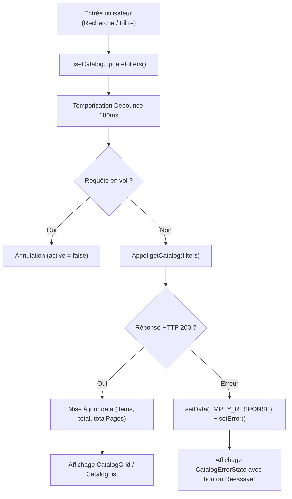
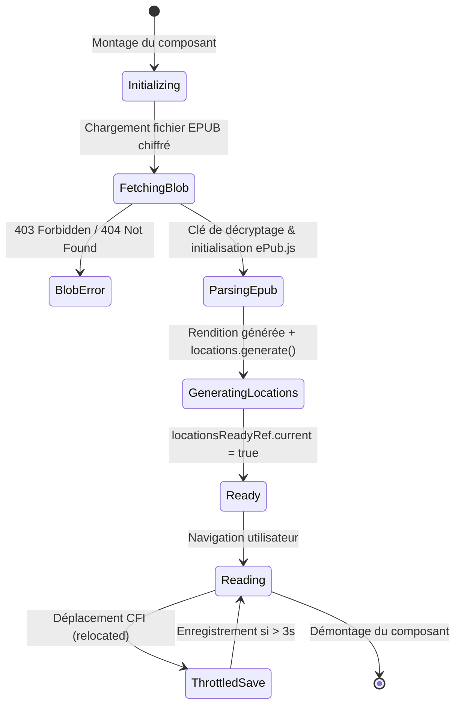

# Audit Exhaustif de Correction Fonctionnelle et Logique — YéYéBook Frontend

**Date de réalisation :** 24 Octobre 2026  
**Auteur :** Comité d'Audit Indépendant — Architecture, Fiabilité et Qualité Logicielle  
**Cible :** Dépôt `yeyebook-pre` (Next.js 14/15 App Router, React 18.3, TypeScript 5.7)  
**Périmètre :** Parcours utilisateurs, logique d'état, invariants métier, frontières d'authentification et de paiement.

---

## 1. Mandat et Démarche d'Audit

Le présent document constitue l'analyse fonctionnelle approfondie et contradictoire de l'application YéYéBook. Contrairement aux audits antérieurs axés sur la compilation, les vulnérabilités de dépendances ou l'inventaire des routes API, cette mission examine la **vérité d'exécution** :
- Les données internes reflètent-elles fidèlement les règles du domaine commercial ?
- Quelles sont les transitions d'état non protégées ou incohérentes ?
- Les promesses fonctionnelles faites à l'utilisateur (achat, possession, lecture, progression, administration) sont-elles garanties en toutes circonstances ?

---

## 2. Cartographie Fonctionnelle et Analyse par Parcours

### 2.1. Parcours 1 : Catalogue, Recherche et Filtrage

#### Objectifs et Invariants Métier
- **INV-CAT-01 :** Le catalogue ne doit afficher que les ouvrages dont le statut est explicitement `published` (sauf dans l'espace administration).
- **INV-CAT-02 :** Tout changement de critère de filtrage (catégorie, recherche textuelle, prix, langue) doit réinitialiser la pagination à la page 1.
- **INV-CAT-03 :** Si l'API renvoie une liste vide, l'état doit distinguer explicitement « Aucun livre dans le catalogue » d'un résultat « Aucun livre ne correspond à vos filtres ».

#### Architecture et Flux d'Exécution
Le catalogue repose sur deux implémentations distinctes dans le code source :
1. Le composant dédié `src/features/catalog/pages/CatalogPage.tsx`, orchestré par le hook `useCatalog` (`src/features/catalog/hooks/useCatalog.ts`).
2. Le chargement initial dans `src/App.tsx` (lignes 440-475) qui alimente l'état racine `books` pour la vitrine d'accueil.



#### Évaluation Critique
- **Points forts :** Le hook `useCatalog` intègre un anti-rebond (*debounce*) de 180 ms via `window.setTimeout` avec un drapeau d'annulation `active = false`. La pagination et les facettes sont synchronisées.
- **Défauts relevés :**
  - **Dédoublement d'état :** `src/App.tsx` conserve un état global `books` chargé à la racine (lignes 440-475) avec `limit: 20`. Si le catalogue total contient 150 livres, `src/App.tsx` n'en a que 20. Dès lors, les sélecteurs de `selectedBook` (lignes 402-410) ou `readerBook` (lignes 411-425) échouent pour les livres situés au-delà de la page 1 si le slug n'est pas réinterrogé via `getBookDetail`.

---

### 2.2. Parcours 2 : Fiche Livre et Recommandations

#### Objectifs et Invariants Métier
- **INV-DET-01 :** Un utilisateur ne doit jamais pouvoir acheter un livre numérique qu'il possède déjà.
- **INV-DET-02 :** La fiche livre doit présenter les boutons d'action appropriés selon le statut de possession : « Lire l'e-book » si possédé, « Acheter » / « Ajouter au panier » sinon.
- **INV-DET-03 :** En cas d'accès direct par URL (`/books/[slug]`), les métadonnées et avis doivent être résolus depuis l'API sans dépendre du préchargement de la page d'accueil.

#### Logique de Détermination de la Possession (`isOwned`)
Dans `src/features/book-details/pages/BookDetailPage.tsx` (lignes 54-55) :
```typescript
const isOwned = owned || (ownedBookIds ? ownedBookIds.has(book.id) : false)
```
Dans `src/App.tsx` (lignes 1096-1107) :
```typescript
const ownsSelected = selectedBook
  ? (Array.isArray(library) && library.includes(selectedBook.id))
  : currentBookSlug
    ? (Array.isArray(library) && library.some((id) => {
        const b = books.find((x) => x.id === id) || purchasedBooks.find((x) => x.id === id)
        return b?.slug === currentBookSlug
      }))
    : false
```

#### Évaluation Critique
- **Défaillance en cascade :** La variable `ownedBookIds` dérive directement du state `library` de `src/App.tsx`. En raison du bug de déconnexion (`handleLogout` ne vidant pas `library`), un utilisateur B ou un visiteur anonyme consultant une fiche livre précédemment achetée par l'utilisateur A voit `isOwned === true`.
- **Conséquence :** Le bouton d'achat est remplacé par « Lire l'e-book ». Au clic, l'accès à l'EPUB est refusé par le serveur avec une erreur 403 Forbidden incompréhensible pour le visiteur.

---

### 2.3. Parcours 3 : Panier et Tunnel de Commande (Checkout)

#### Objectifs et Invariants Métier
- **INV-CART-01 :** Le catalogue étant composé d'e-books numériques, la quantité pour chaque article est strictement plafonnée à 1 (`MAX_CART_QUANTITY = 1`).
- **INV-CART-02 :** L'ajout d'un livre déjà présent dans le panier ne doit pas incrémenter la quantité mais informer l'utilisateur.
- **INV-CART-03 :** Un livre possédé dans la bibliothèque ne peut pas être ajouté au panier.
- **INV-CART-04 :** Le passage de commande exige une authentification formelle afin de lier la commande et les licences au compte de l'acquéreur.

#### Table de Décision : Ajout au Panier (`addToCart`)

| Condition Initiale | Action Utilisateur | Résultat Attendu | Résultat Constaté |
| :--- | :--- | :--- | :--- |
| Livre non possédé, non présent au panier | Clic « Ajouter au panier » | Ajouté avec quantité 1, notification succès | Conforme (`cartItems.length + 1`) |
| Livre déjà présent au panier | Clic « Ajouter au panier » | Notification « Livre déjà dans votre panier », pas de doublon | Conforme (filtrage par `bookId`) |
| Livre possédé par l'utilisateur | Clic « Ajouter au panier » | Notification « Vous possédez déjà ce livre », refus d'ajout | Conforme (vérification `ownedBookIds`) |
| Utilisateur non connecté | Clic « Passer la commande » | Redirection vers login avec conservation du panier et de la destination | **NON CONFORME** (perte de redirection) |

#### Évaluation Critique : Hydratation Asynchrone et Flash d'État Vide
Dans `src/App.tsx` :
- `cartItems` est initialisé à `[]` (ligne 270).
- `cartHydrated` est initialisé à `false` (ligne 271).
- Le chargement depuis le `localStorage` s'opère dans un `useEffect` (lignes 640-645).
- Dans `CheckoutView` (lignes 3169-3184), le composant évalue immédiatement :
  ```typescript
  if (cartItems.length === 0) {
    return <div>Votre panier est vide</div>
  }
  ```
- **Constat :** Lors d'un rechargement ou d'un accès direct à `/checkout`, l'utilisateur subit un flash visuel « Votre panier est vide » pendant 50 à 150 ms avant que le `useEffect` ne peuple le panier.

---

### 2.4. Parcours 4 : Retour de Paiement et Confirmation

#### Objectifs et Invariants Métier
- **INV-PAY-01 :** Seul le backend FastAPI est habilité à attester du statut `paid` d'une commande via `confirmPaymentApi(id)`.
- **INV-PAY-02 :** Aucun paramètre d'URL (ex: `?status=approved`) ne doit être cru sur parole par le frontend.
- **INV-PAY-03 :** Le panier local ne doit être vidé **QUE SI ET SEULEMENT SI** le backend confirme `order_status === "paid"`.
- **INV-PAY-04 :** En cas d'échec d'initialisation du paiement (absence d'URL de redirection FedaPay), l'application ne doit en aucun cas simuler un succès.

#### Analyse des Deux Chemins de Confirmation
1. **La route dédiée `/checkout/retour` (`src/app/checkout/retour/page.tsx`) :**
   - Cette page applique une vérification stricte : elle extrait `id`, ignore `?status=...`, appelle `confirmPaymentApi(id)`, et ne vide le panier que si `data.order_status === "paid"`.
   - Les états `pending`, `declined` et `error` sont gérés avec précision.
2. **Le gestionnaire de commande dans le shell client (`placeOrder` dans `src/App.tsx`, lignes 887-900) :**
   - **VULNÉRABILITÉ CRITIQUE :**
     ```typescript
     if (paymentRes.payment?.payment_url) {
       showToast("Redirection vers la passerelle sécurisée FedaPay...", "success")
       window.location.href = paymentRes.payment.payment_url
       return
     }

     setLibrary((prev) =>
       Array.from(new Set([...prev, ...cartItems.map((i) => i.bookId)])),
     )
     setCartItems([])
     void refreshLibrary()
     setView("confirmation")
     showToast("Paiement confirmé — bonne lecture !", "success")
     ```
   - Si `paymentRes.payment?.payment_url` est `null`, `undefined` ou absent de la réponse serveur (panne de l'opérateur FedaPay, réponse partielle, ou payload inattendu), le code **bypasse intégralement le paiement**, s'attribue les livres dans `library`, vide le panier et annonce un paiement confirmé.

---

### 2.5. Parcours 5 : Bibliothèque et Liseuse EPUB

#### Objectifs et Invariants Métier
- **INV-LIB-01 :** La bibliothèque d'un utilisateur ne doit contenir que les livres pour lesquels il dispose d'un droit d'accès validé par le backend.
- **INV-LIB-02 :** À la déconnexion, toutes les données de bibliothèque, commandes et statistiques personnelles doivent être purgées de la mémoire vive.
- **INV-READ-01 :** La progression de lecture (pourcentage et CFI EPUB) doit être persistée de manière fiable sans écraser une progression supérieure par un état initial non calibré (`percent: 0`).
- **INV-READ-02 :** La fermeture du lecteur ou le changement de page ne doit pas entraîner la perte de la position actuelle.

#### Machine à États de la Liseuse (`EpubWebReader.tsx`)



#### Évaluation Critique de la Sauvegarde de Progression
Dans `src/features/reader/EpubWebReader.tsx` (lignes 292-297) :
```typescript
const now = Date.now()
// Enregistrement au plus toutes les 3 secondes si le CFI change
if (lastSavedRef.current.cfi !== cfi && now - lastSavedRef.current.time > 3000) {
  lastSavedRef.current = { cfi, time: now }
  void saveBookReadingProgress(book.id, { cfi, percent })
}
```
- **Défaillance constatée :** Il n'existe aucun mécanisme de rappel différé (*trailing debounce*) ni de sauvegarde lors du démontage (`useEffect` cleanup / `beforeunload`).
- **Scénario de perte :** Un lecteur tourne 5 pages en 2,5 secondes, puis clique sur « Retour à la bibliothèque » ou ferme son onglet. La dernière page lue est rejetée par la condition `now - time > 3000` et n'est jamais transmise au serveur.

---

### 2.6. Parcours 6 : Espace Administrateur

#### Objectifs et Invariants Métier
- **INV-ADM-01 :** Seuls les utilisateurs dotés du rôle `admin`, `super_admin` ou `moderator` ont accès au panneau de gestion.
- **INV-ADM-02 :** Toute modification de catalogue (création, édition, suppression, statut de publication) doit être synchronisée avec le backend avant de confirmer l'action à l'utilisateur.
- **INV-ADM-03 :** En cas d'échec d'une opération serveur (ex: 403 Forbidden, 422 Unprocessable Entity, 500 Server Error), l'état optimiste de l'interface doit être annulé (*rollback*).

#### Évaluation Critique des Mises à Jour Optimistes dans `src/App.tsx`
Dans les fonctions d'administration (lignes 913-1018) :
1. **Suppression de livre (`deleteBook`, lignes 964-978) :**
   ```typescript
   setBooks((prev) => prev.filter((b) => b.id !== id))
   try {
     const res = await deleteAdminBookApi(id)
     showToast(res.message, "success")
   } catch (err) {
     console.warn("[Admin API] Synchronisation suppression livre:", err)
     showToast(`« ${book?.title ?? "Titre"} » retiré du catalogue`, "warning")
   }
   ```
   *Anomalie :* En cas d'erreur de suppression côté backend, le toast annonce quand même que le livre a été retiré, et le livre n'est jamais réinséré dans `books`. L'administrateur pense que le livre est supprimé, alors qu'il reste publié sur la base de données !
2. **Sauvegarde de livre (`saveBook`, lignes 913-962) :**
   Le toast de succès est affiché à la ligne 920, **avant** même l'exécution de l'appel API `createAdminBookApi` ou `updateAdminBookApi`. En cas d'échec réseau, le livre conserve un identifiant provisoire généré côté client et l'erreur est avalée silencieusement par un simple `console.warn`.
3. **Changement de statut de commande (`setOrderStatus`, lignes 1006-1018) :**
   L'état local est mis à jour immédiatement, et en cas d'échec de `updateOrderStatusApi`, aucun rollback n'est appliqué.

---

### 2.7. Parcours 7 : Authentification et Cycle de Vie de Session

#### Objectifs et Invariants Métier
- **INV-AUTH-01 :** À la déconnexion, l'ensemble des données nominatives et privées de l'utilisateur doit être effacé.
- **INV-AUTH-02 :** Lorsqu'un jeton de session expire et que le renouvellement silencieux (*Silent Refresh*) échoue, l'interface doit immédiatement basculer vers l'état déconnecté.
- **INV-AUTH-03 :** Un rafraîchissement d'onglet ou une expiration de session ne doit pas maintenir de faux états connectés.

#### Évaluation Critique : La Fuite Cross-Utilisateur au Logout
Dans `src/App.tsx` (lignes 1257-1265) :
```typescript
const handleLogout = async () => {
  console.log("[YéYéBook Auth] Déconnexion (handleLogout)")
  await logout()
  setSessionUser(null)
  setProgress({})
  showToast("Vous êtes déconnecté·e.", "default")
  setView("home")
  router.push("/")
}
```
- **Faute logique caractérisée :** `handleLogout` oublie de réinitialiser :
  - `library` (`setLibrary([])`)
  - `purchasedBooks` (`setPurchasedBooks([])`)
  - `orders` (`setOrders([])`)
  - `libraryStats` (`setLibraryStats(null)`)
- **Conséquence directe :** Si un utilisateur B se connecte ensuite sur la même machine sans avoir encore acheté de livres, la fonction `refreshLibrary` constate `items.length === 0` et ne touche pas aux listes existantes. L'utilisateur B hérite visuellement des livres, des commandes et des statistiques de l'utilisateur A.

#### Évaluation Critique : Expiration Silencieuse Non Répercutée
Dans `src/features/auth/auth.api.ts` (lignes 112-116) :
```typescript
if (typeof window !== "undefined") {
  setOnSessionExpired(() => {
    saveCachedUser(null)
  })
}
```
- Le callback appelé par `apiClient` lors d'un échec de Silent Refresh se contente de vider `localStorage`.
- Aucun événement personnalisé (`window.dispatchEvent`) n'est émis vers l'arbre React de `App.tsx`.
- L'état `sessionUser` de React demeure non nul. L'utilisateur continue de voir son profil connecté et reçoit des erreurs 401 à chaque action sans comprendre la cause.

---

## 3. Synthèse de la Cohérence Fonctionnelle

L'analyse révèle que l'architecture modulaire créée sous `src/features/*` (gestion du panier, page de retour de paiement, hook catalogue) respecte des principes rigoureux. En revanche, le shell central `src/App.tsx` (5 324 lignes) maintient en parallèle une gestion d'état manuelle, des copies locales non synchronisées, des optimisations prématurées non rollbackées et un nettoyage incomplet de session.

Ce grand écart entre la rigueur des modules périphériques et les approximations du shell central est la source des vulnérabilités fonctionnelles identifiées dans ce rapport.
