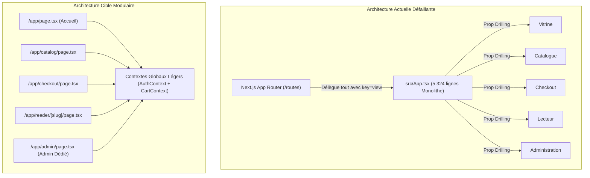

# Audit de Lisibilité, Maintenabilité et Dette Technique — YéYéBook Frontend

**Date de réalisation :** 24 Octobre 2026  
**Auteur :** Comité d'Audit Indépendant — Architecture et Génie Logiciel  
**Cible :** Dépôt `yeyebook-pre`  
**Méthodologie :** Analyse statique du code, métriques de complexité cyclomatique, évaluation selon les principes SOLID et audit anti-sur-ingénierie (Ponytail).

---

## 1. Diagnostic Global de Maintenabilité

L'audit de la structure du code met en lumière une fracture architecturale nette entre :
1. **Les modules fonctionnels (`src/features/*`) :** Bien découpés, hautement lisibles, typés avec rigueur, testables unitairement et dotés d'une séparation claire entre la couche API, les hooks et les composants d'interface.
2. **Le shell client géant (`src/App.tsx`, 5 324 lignes) :** Un monolithe historique hérité de la transition Vite vers Next.js, concentrant la quasi-totalité de l'état global, des routes, des modales, des gestionnaires d'événements et des interfaces administratives.

```
+-----------------------------------------------------------------------------------+
| RAPPORT DE SANTÉ DU CODE (SCORECARD DE MAINTENABILITÉ)                           |
+-----------------------------------------------------------------------------------+
| Axe d'Évaluation                  | Note / 10 | Diagnostic synthétique            |
+-----------------------------------+-----------+-----------------------------------+
| 1. Lisibilité des modules métier  |   8.5/10  | Features propres et documentées.  |
| 2. Modularité architecturale      |   4.0/10  | Écrasée par le monolithe App.tsx. |
| 3. Prévisibilité du flux d'état   |   3.5/10  | États croisés et synchronisations |
|                                   |           | manuelles hasardeuses.            |
| 4. Hygiène du typage TypeScript   |   7.0/10  | Globalement solide mais quelques  |
|                                   |           | casts brutaux ("as unknown as").  |
| 5. Facilité de modification sans  |   3.0/10  | Risque critique de régression     |
|    régression (Shell App.tsx)     |           | lors de toute retouche dans App.  |
+-----------------------------------------------------------------------------------+
| SCORE GLOBAL DE MAINTENABILITÉ   |   5.2/10  | DETTE TECHNIQUE MAJEURE           |
+-----------------------------------------------------------------------------------+
```

---

## 2. Anatomie Critique du Monolithe `src/App.tsx` (5 324 Lignes)

### 2.1. Violation Massive du Principe de Responsabilité Unique (SRP)
Dans une architecture Next.js moderne avec App Router, chaque page de route gère ses données et son cycle de vie. Dans YéYéBook :
- `src/App.tsx` regroupe en son sein plus de **45 variables d'état React** (`useState`), **22 effets de bord** (`useEffect`) et **60 fonctions gestionnaires**.
- Il gère simultanément :
  1. Le routage interne virtuel (`view: "home" | "catalog" | "details" | "cart" | "checkout" | "confirmation" | "library" | "reader" | "admin" | "login" | "register"`).
  2. La gestion du panier d'achat et le calcul des totaux.
  3. L'exécution de la commande et l'appel de paiement.
  4. La synchronisation de la bibliothèque utilisateur et des commandes.
  5. Le cycle de vie complet de l'espace administration (création, édition, suppression de livres, uploads de fichiers, changement de statuts de commande).
  6. Les préférences du lecteur EPUB (thème, taille de police, interligne, marque-pages).
  7. L'affichage des toasts et notifications globales.
  8. L'ouverture et la fermeture des modales légales (CGV, Mentions légales, Confidentialité).

### 2.2. Le Phénomène du « Prop Drilling » Extrême
Pour alimenter les composants enfants, `src/App.tsx` transmet manuellement des dizaines de props à travers l'arbre de rendu :
```tsx
// Exemple : Invocation de CheckoutView (lignes 2229-2243)
<CheckoutView
  books={books}
  cartItems={cartItems}
  total={cartTotal}
  user={sessionUser}
  loading={checkoutLoading}
  onBack={() => { setView("catalog"); setCartOpen(true); }}
  onLogin={() => go("login")}
  onRegister={() => go("register")}
  onPlaceOrder={placeOrder}
/>
```
Lorsqu'un nouveau besoin métier apparaît, le développeur est contraint de traverser tout `App.tsx`, d'ajouter une nouvelle prop, un nouvel état, et de modifier les interfaces intermédiaires.

### 2.3. Démontage Brutal à Chaque Transition d'URL
Dans `src/app/route-entry.tsx` :
```tsx
export function RouteEntry({ view = "home", bookSlug, readerSlug }) {
  return (
    <App
      key={view}
      initialView={view}
      initialBookSlug={bookSlug}
      initialReaderSlug={readerSlug}
    />
  )
}
```
La présence de `key={view}` force React à **démonter complètement l'arbre de composants** à chaque changement de page.
- Le cache en mémoire vive est détruit.
- Tous les `useEffect` initiaux de `App.tsx` (chargement du catalogue, vérification de session, lecture du localStorage) se réexécutent inutilement.
- Le bénéfice fondamental du Single Page Application (SPA) et de Next.js App Router (persistance de mise en page, streaming, transitions douces) est totalement annulé.

---

## 3. Duplication de Code et Fragmentation Architecturale

L'application présente une étrange redondance : un même concept métier existe sous deux formes différentes dans le dépôt.

| Fonctionnalité | Implémentation Modulaire Moderne | Implémentation Redondante dans `src/App.tsx` | Risque de Divergence |
| :--- | :--- | :--- | :--- |
| **Catalogue & Filtres** | `src/features/catalog/` (`CatalogPage`, `useCatalog`, `catalog.api.ts`) | Chargement d'accueil codé en dur (lignes 440-475) avec tri et limite séparés | Élevé : les deux codes n'appliquent pas les mêmes transformations sur les livres |
| **Détail du Livre** | `src/features/book-details/` (`BookDetailPage`, `useBookDetail`) | Mécanisme de sélection interne `selectedBook` / `openBook` | Moyen : confusion sur la provenance de la donnée affichée |
| **Panier d'Achat** | `src/features/cart/` (`cart.storage.ts`, `types.ts`) | États `cartItems`, `cartHydrated`, recalcul inline `cartTotal` | Élevé : règles métier dupliquées |
| **Administration** | `src/features/admin/` (`AdminBookEditor.tsx`, `admin.api.ts`) | 1 500 lignes de tableaux, modales et formulaires inline dans `src/App.tsx` | Critique : deux implémentations de l'éditeur de livres en concurrence |

---

## 4. Analyse Anti-Sur-Ingénierie (Audit Ponytail)

Conformément aux principes de développement frugal et direct :
- **Ce qui est sain :**
  - Pas de dépendances lourdes superflues (pas de Redux Toolkit, MobX ou React Query surdimensionné pour un projet de cette taille).
  - Utilisation des primitives du standard web (`fetch`, `AbortController`, `localStorage`, `sessionStorage`).
  - Pas de micro-abstractions abstraites ou de fabriques inutiles.
- **Ce qui est anti-frugal :**
  - **La complexité accidentelle due au non-découpage :** Avoir voulu conserver un unique fichier de 5 324 lignes crée une complexité cognitive phénoménale. Un développeur doit lire des milliers de lignes pour comprendre le flux d'un simple clic sur « Déconnexion ».
  - **Le double routing :** Avoir un routeur Next.js App Router (`src/app/*`) qui délègue à un routeur interne virtuel (`view: "home" | "catalog" | ...`) basé sur un `switch(view)` géant est une sur-ingénierie inversée : on a combiné les contraintes des deux approches sans profiter des atouts de l'une ou de l'autre.

---

## 5. Hygiène du Typage TypeScript

Le projet bénéficie d'une compilation TypeScript stricte (`tsc --noEmit` passe sans erreur).
Cependant, l'analyse du code source relève plusieurs concessions de typage fragilisant la sécurité d'exécution :
1. **Casts brutaux `as unknown as` :**
   ```typescript
   // src/App.tsx, ligne 453
   const rawBook = book as unknown as { chapters?: Chapter[] }
   ```
   Ce type de cast contourne la vérification statique et masque d'éventuelles discordances avec le schéma réel de l'API.
2. **Utilisation résiduelle de `any` dans les modules complexes :**
   Dans `src/features/reader/EpubWebReader.tsx` (lignes 306-307) :
   ```typescript
   let renditionInstance: any = null
   let bookInstance: any = null
   ```
   Bien que justifié temporairement par le manque de typage officiel d'ePub.js 0.3, cela prive le développeur de l'autocomplétion et de la détection d'erreurs sur l'un des composants les plus sensibles de l'application.

---

## 6. Plan d'Action Recommandé pour la Refactorisation Structurelle

Pour transformer ce prototype avancé en une application maintenable à long terme sans risque pour l'entreprise :



### Étapes Prioritaires :
1. **Étape 1 (Immédiate) :** Isoler l'authentification et le panier dans des React Contexts partagés (`AuthContext`, `CartContext`), éliminant 80% du prop drilling de `src/App.tsx`.
2. **Étape 2 (Court terme) :** Remplacer le routage virtuel `RouteEntry` en migrant chaque vue vers sa page App Router native (`src/app/catalog/page.tsx`, `src/app/library/page.tsx`, etc.).
3. **Étape 3 (Moyen terme) :** Extraire l'administration (`AdminView`, ~1 500 lignes) dans un sous-arbre totalement isolé (`src/app/yeye-admin-admin/page.tsx`), garantissant qu'aucun code administratif n'est téléchargé par les visiteurs ordinaires.
