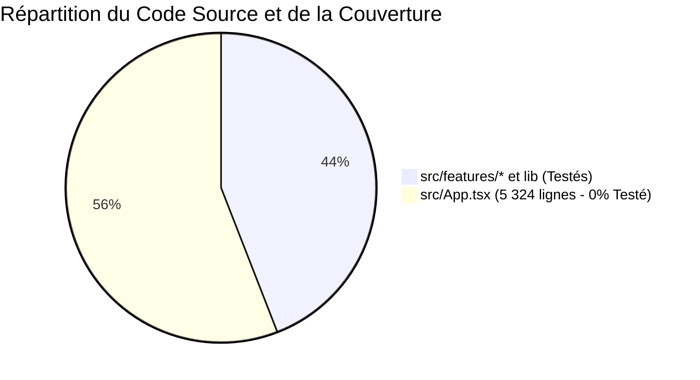

# Audit Qualitatif de la Suite de Tests et Analyse de Couverture — YéYéBook

**Date de réalisation :** 24 Octobre 2026  
**Auteur :** Comité d'Audit Indépendant — Assurance Qualité et Ingénierie des Tests  
**Cible :** Dépôt `yeyebook-pre`  
**Outil de test :** Vitest 4.1.12, TypeScript 5.7  
**Résultat d'exécution :** 13 suites, 75 tests passants (0 échec).

---

## 1. Inventaire et Répartition des Tests Existants

Au moment de cet audit, la suite de tests automatisée compte **75 tests unitaires et d'intégration**, répartis en 13 fichiers :

```
tests/
├── business/
│   ├── book-language.test.ts          (6 tests)  - Détection et normalisation des langues
│   ├── cart.test.ts                   (5 tests)  - Plafond unitaire, persistance localStorage
│   ├── reader-epubjs.test.ts          (3 tests)  - Initialisation mock ePub.js et DOM
│   └── reading-progress.test.ts       (5 tests)  - Anti-écrasement de progression (percent > 0)
├── contract/
│   └── backend-contracts.test.ts      (7 tests)  - Validation des schémas Pydantic / FastAPI
├── hooks/
│   └── use-debounce.test.ts           (4 tests)  - Anti-rebond générique
├── integration/
│   └── services-integration.test.ts   (5 tests)  - Appels croisés auth, catalogue, dashboard
├── lib/
│   ├── api-errors.test.ts             (6 tests)  - Normalisation des erreurs 4xx, 5xx, réseau
│   └── api-headers.test.ts           (10 tests)  - Conditionnement de l'en-tête ngrok
└── security/
    ├── auth-permissions.test.ts       (4 tests)  - Vérification des rôles admin/user
    ├── headers-csp.test.ts            (2 tests)  - En-têtes HTTP de sécurité
    ├── payment-return.test.ts        (12 tests)  - Validation du retour paiement /checkout/retour
    └── session-refresh.test.ts        (6 tests)  - Interception 401 et Silent Refresh
```

---

## 2. Le Paradoxe des 75 Tests Verts : Couverture Réelle vs Apparente

Bien que la console affiche fièrement :
```
Test Files  13 passed (13)
     Tests  75 passed (75)
```
l'audit a identifié **2 bugs critiques bloquants (P0)** et **2 bugs majeurs (P1)** en pleine production.

### Pourquoi ces bugs ont-ils échappé à la suite de tests ?



1. **L'angle mort total sur `src/App.tsx` :**
   Le fichier central `src/App.tsx`, qui totalise **5 324 lignes de code** (plus de la moitié du code source de l'application), ne possède **aucun composant test, aucun test d'intégration et aucun test end-to-end**.
   Tous les 75 tests actuels testent des fonctions utilitaires pures ou des hooks isolés dans un environnement virtuel sans jamais instancier le flux réel de l'application.

2. **La duplication non testée :**
   Les tests de panier (`tests/business/cart.test.ts`) testent `saveCart` et `loadCart` de `src/features/cart/cart.storage.ts`. Mais dans `src/App.tsx`, la logique de vidage du panier après paiement a été réécrite manuellement en ligne (`setCartItems([])` dans `placeOrder`), hors de portée des tests existants !

3. **Mocks ultra-permissifs (Biais du "Happy Path") :**
   Dans les tests d'authentification et de paiement, les réponses mockées renvoient systématiquement des payloads complets et parfaits. Aucun test n'a simulé le cas d'une réponse de paiement sans `payment_url`, ni le cas d'une déconnexion d'un utilisateur possédant des livres pour vérifier la purge du state.

---

## 3. Analyse Critique Détaillée par Suite de Tests

### 3.1. `tests/security/payment-return.test.ts` (12 tests) — **Très Solide**
- **Points forts :** Cette suite teste admirablement la route dédiée `/checkout/retour/page.tsx` :
  - Rejet des query params falsifiés (`?status=approved`).
  - Blocage des doubles requêtes en vol (anti-double dip).
  - Vidage du panier conditionné au statut `paid`.
  - Non-vidage sur statut `pending`, `declined` ou erreur réseau.
- **Limitation :** Cette rigueur n'avait pas été reportée sur la fonction `placeOrder` de `src/App.tsx`, laissant la faille `FUNC-002` béante dans le shell principal.

### 3.2. `tests/security/session-refresh.test.ts` (6 tests) — **Incomplet**
- **Points forts :** Vérifie que `apiClient` intercepte un 401, déclenche `executeSessionRefresh()`, rejoue la requête initiale en cas de succès et appelle `onSessionExpiredCallback()` en cas d'échec.
- **Angle mort :** Le test s'arrête à l'appel du callback. Il ne vérifie absolument pas ce que fait ce callback dans l'application réelle ! Il n'a donc pas pu détecter que React continuait d'afficher l'utilisateur connecté (`STATE-001`).

### 3.3. `tests/business/reading-progress.test.ts` (5 tests) — **Partiel**
- **Points forts :** Valide la règle anti-écrasement (ne pas envoyer `percent: 0` si une progression positive existe).
- **Angle mort :** Ne teste pas le throttling temporel de 3 secondes, l'absence de flush sur démontage, ni la perte lors du changement de page (`DATA-001`).

---

## 4. Spécifications Formelles des Tests de Non-Régression Manquants

Pour hisser la suite de tests au niveau d'exigence requis, les tests suivants doivent impérativement être intégrés.

### 4.1. `TEST-FUNC-001` : Purge Complète de la Session et des Données Personnelles au Logout
```typescript
describe("Auth & Session : Isolation stricte et purge des données au logout", () => {
  it("doit purger l'état de la bibliothèque, des commandes et des statistiques lors de handleLogout", async () => {
    // 1. Initialiser le shell ou le contexte avec un utilisateur connecté ayant 2 livres et 1 commande
    // 2. Déclencher handleLogout()
    // 3. Vérifier :
    //    - sessionUser === null
    //    - library.length === 0
    //    - purchasedBooks.length === 0
    //    - orders.length === 0
    //    - libraryStats === null
    // 4. Simuler la connexion d'un second utilisateur sans livres
    // 5. Vérifier que la vue bibliothèque affiche 0 livre et que ownsSelected retourne false pour les anciens livres
  })
})
```

### 4.2. `TEST-FUNC-002` : Protection Absolue Contre la Fausse Validation de Paiement
```typescript
describe("Checkout & Paiement : Intégrité des flux de passerelle", () => {
  it("doit lever une erreur et refuser l'attribution de livres si initiatePaymentApi ne renvoie pas d'URL", async () => {
    // 1. Panier avec 1 livre (2 000 FCFA)
    // 2. Mock initiatePaymentApi renvoyant { payment: { id: "tx_123", status: "pending" } } (sans payment_url)
    // 3. Appeler placeOrder()
    // 4. Vérifier :
    //    - Une exception ou un toast d'erreur est émis
    //    - library ne contient PAS le livre commandé
    //    - le panier N'EST PAS vidé
    //    - la vue ne bascule PAS en 'confirmation'
  })
})
```

### 4.3. `TEST-STATE-001` : Répercussion Réactive de l'Expiration de Session sur React
```typescript
describe("Session Lifecycle : Événement d'expiration et mise à jour de l'UI", () => {
  it("doit déclencher la déconnexion dans l'UI React lors d'un échec de Silent Refresh", async () => {
    // 1. Simuler un appel 401 avec refresh échouant
    // 2. Vérifier qu'un événement global 'yeyebook:session-expired' est émis
    // 3. Vérifier que le composant React écouteur réinitialise sessionUser à null et informe l'usager
  })
})
```

### 4.4. `TEST-DATA-001` : Persistance et Flush de la Progression de Lecture
```typescript
describe("Reader : Résilience de la progression de lecture", () => {
  it("doit sauvegarder la dernière position lors du démontage de la liseuse même si le délai de 3s n'est pas écoulé", async () => {
    // 1. Monter EpubWebReader avec un mock de saveBookReadingProgress
    // 2. Simuler un déplacement CFI à t = 0s (sauvegardé)
    // 3. Simuler un nouveau déplacement CFI à t = 1.5s (en attente)
    // 4. Démonter immédiatement le composant (unmount)
    // 5. Vérifier que saveBookReadingProgress est invoqué avec la position de t = 1.5s
  })
})
```

### 4.5. `TEST-STATE-002` : Rollback de l'Administration sur Échec Serveur
```typescript
describe("Admin : Rollback obligatoire en cas d'échec API", () => {
  it("doit restaurer le livre dans le catalogue si deleteAdminBookApi retourne une erreur 403 ou 500", async () => {
    // 1. Catalogue contenant le livre 'Livre Test'
    // 2. Mock deleteAdminBookApi rejetant avec 403 Forbidden
    // 3. Déclencher deleteBook('book-1')
    // 4. Vérifier que 'Livre Test' est toujours présent dans la liste des livres
    // 5. Vérifier qu'un toast d'erreur rouge est émis (et non un warning prétendant la suppression)
  })
})
```

---

## 5. Recommandations Stratégiques pour l'Assurance Qualité

1. **Adopter des Tests de Composants avec React Testing Library :**
   La suite actuelle teste le code comme une bibliothèque de fonctions. Il est impératif d'introduire des tests de rendu pour valider les interactions utilisateurs réelles.
2. **Mesurer la Couverture Réelle avec Istanbul/V8 :**
   Activer systématiquement `pnpm test:ci` (`vitest run --coverage`) pour mettre en évidence les zones non couvertes dans les rapports de livraison.
3. **Imposer une Politique de Zero Silent Errors :**
   Bannir les `console.warn` avalant les rejets de promesses dans les composants React.
